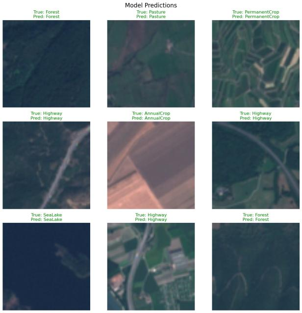
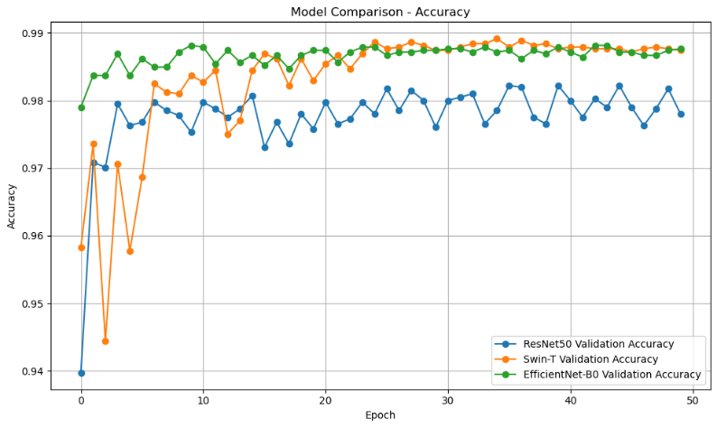
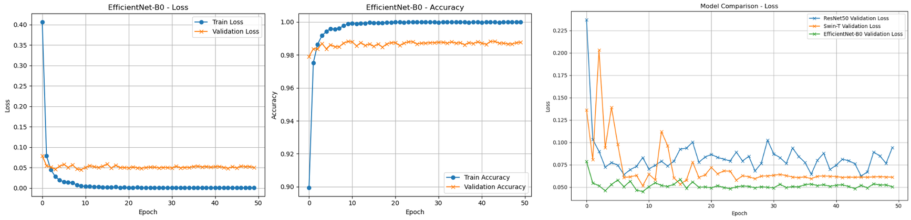
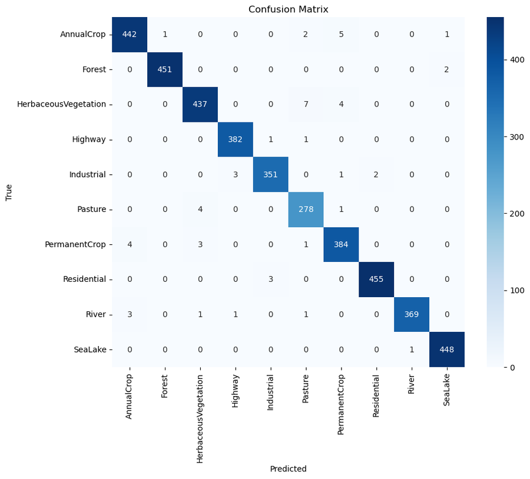

# Satellite Image Classification & LULC Mapping: Deep Learning Benchmarking on Sentinel-2 (EuroSAT)

A comprehensive deep learning comparative benchmark evaluating Convolutional Neural Networks (**ResNet-50**, **EfficientNet-B0**) and Vision Transformers (**Swin Transformer Tiny**) for automated Land Use and Land Cover (LULC) classification using ESA Sentinel-2 multispectral imagery.

📄 **[Read the Full Technical Report (PDF - Greek)](./Deep_Learning_Satellite_Image_Classification_Report.pdf)**

---

## 📌 Project Overview
Automated classification of Earth Observation (EO) satellite data plays a vital role in urban planning, environmental change detection, and natural resource management. This project addresses the spectral complexity and cross-class visual similarity inherent in satellite tiles by implementing and benchmarking state-of-the-art vision architectures.

* **Dataset:** EuroSAT (Sentinel-2, 27,000 georeferenced images across 10 LULC classes: Annual Crop, Forest, Herbaceous Vegetation, Highway, Industrial, Pasture, Permanent Crop, Residential, River, Sea/Lake).
* **Data Split:** 70% Training | 15% Validation | 15% Testing.
* **Environment:** PyTorch, torchvision, timm, scikit-learn, CUDA GPU acceleration.

  
   <em>Sample predictions of EfficientNet-B0 on Sentinel-2 tiles (true vs. predicted class)</em>

---

## 🏗️ Evaluated Architectures & Methodologies

1. **ResNet-50:**
   * Utilizes residual skip-connections to mitigate vanishing gradients in deep networks.
   * Serves as a solid and interpretable baseline for geospatial feature extraction.

2. **EfficientNet-B0:**
   * Employs compound scaling balancing network depth, width, and image resolution with MBConv (Mobile Inverted Bottleneck) and squeeze-and-excitation optimization.
   * Delivers high performance suitable for resource-constrained or embedded geospatial workflows.

3. **Swin Transformer Tiny:**
   * Hierarchical Vision Transformer utilizing shifted local windows for self-attention computation.
   * Captures fine-grained multi-scale context across complex satellite surface textures.

All models were fine-tuned from ImageNet-pretrained checkpoints using the **Adam** optimizer with weight decay, **CrossEntropyLoss**, and a dynamic **ReduceLROnPlateau** learning rate scheduler over 50 epochs (batch size = 32).

---

## 📊 Experimental Results

| Model Architecture | Test Accuracy | Macro F1-Score | Training Time |
| :--- | :---: | :---: | :---: |
| **EfficientNet-B0** | **98.89%** | **98.84%** | **5,368 sec** (~1.5 h) |
| **Swin Transformer Tiny** | **98.69%** | **98.63%** | 11,656 sec (~3.2 h) |
| **ResNet-50** | 97.73% | 97.60% | 7,666 sec (~2.1 h) |

  
   <em>Validation accuracy of the three architectures over 50 epochs</em>

  
   <em>EfficientNet-B0 training/validation curves (left) and validation loss of all models (right)</em>

  
   <em>Confusion matrix of EfficientNet-B0 on the test set</em>

### Key Findings
* **Optimal Trade-off:** EfficientNet-B0 achieved the highest overall accuracy (98.89%) with the lowest computational footprint and fastest training convergence.
* **Attention vs. Convolutions:** Swin Transformer demonstrated strong spatial modeling capability on intricate texture boundaries, yielding near-optimal F1-score with slightly higher training time due to window self-attention overhead.
* **Confusion Analysis:** Minor confusion occurred only between visually adjacent categories (e.g., Highway vs. Annual Crop / Pasture vs. Herbaceous Vegetation).

---

## 🛠️ Tech Stack & Libraries
* **Frameworks:** PyTorch, timm (PyTorch Image Models), torchvision, scikit-learn
* **Analysis & Visualization:** NumPy, Pandas, Matplotlib, Seaborn (Confusion Matrices, Loss/Accuracy curves)
* **Domain:** Remote Sensing, Earth Observation (EO), Computer Vision, Deep Learning
